# Tissue-Balanced Attenuation Map Estimation from Dual-Window SPECT for Deep-Learning-Based CT-less Reconstruction: A Multi-Vendor Clinical Evaluation with Matched OSEM

**Authors:** Fenghua Weng, et al.  
**Affiliations:** Department of Nuclear Medicine and Biomedical Engineering.  
**Corresponding Author:** Fenghua Weng (Email: fenghua.weng@alumni.sjtu.edu.cn).

## Abstract

**Purpose:** To develop and evaluate a physics-grounded, CT-less single-photon emission computed tomography (SPECT) attenuation correction paradigm (**PU-MAENet**) that directly estimates patient-specific linear attenuation coefficient maps ($\mu$-maps) from dual-window emission acquisitions and reconstructs tracer activity using deterministic, matched ordered-subset expectation maximization with point-spread-function modeling (AC-PSF-OSEM).

**Methods:** A conditional three-dimensional residual U-Net was designed to predict 140-keV attenuation maps from two-iteration non-attenuation-corrected (NAC) reconstructions of photopeak ($x_{\text{photo}}$) and lower scatter-window ($x_{\text{scat}}$) projections. The network incorporates scanner geometry conditioning via Feature-wise Linear Modulation (FiLM), a strictly positive softplus output parameterization, and an asymmetric tissue-balanced objective that explicitly counters bone voxel sparsity (<5% of body volume). The study cohort comprises 1,319 clinical $^{99\text{m}}\text{Tc}$-MDP bone SPECT examinations from GE Discovery 670 Pro and Siemens Symbia platforms, partitioned with strict patient-level separation into 952 training, 183 validation, and 184 locked held-out testing examinations (164 GE and 20 Siemens). Predicted and reference CT-derived attenuation maps were separately supplied to otherwise identical eight-iteration AC-PSF-OSEM solvers. Evaluation included full-volume and acquisition-supported attenuation accuracy, whole-volume activity recovery, automated bone-hotspot bias, multi-method benchmarking against five alternative correction paradigms, an independent 15-case batch verification, and a controlled four-arm component ablation study trained from a common random seed.

**Results:** Across the 184 locked held-out test examinations, full-volume attenuation-map peak signal-to-noise ratio (PSNR) was $29.80 \pm 3.22\text{ dB}$ (supported: $30.10 \pm 1.71\text{ dB}$, SSIM: $0.8922 \pm 0.0252$), with supported bone mean absolute error (MAE) of $0.0197 \pm 0.0070\text{ cm}^{-1}$ ($0.0187 \pm 0.0056\text{ cm}^{-1}$ for GE; $0.0281 \pm 0.0111\text{ cm}^{-1}$ for Siemens). Downstream activity reconstructions achieved supported PSNR of $52.95 \pm 4.34\text{ dB}$ (full-volume: $54.44 \pm 4.32\text{ dB}$, supported SSIM: $0.9972 \pm 0.0020$). Signed bone-hotspot maximum bias was restricted to $+6.09 \pm 7.67\%$, dramatically outperforming uncorrected NAC SPECT ($-84.2 \pm 6.8\%$ severe underestimation) and conventional Chang's uniform attenuation correction ($-28.5 \pm 8.4\%$ bias with severe thoracic halo artifacts). In the independent 15-case batch evaluation, 3D activity Pearson correlation reached $r = 0.9902 \pm 0.0051$ (range: 0.9775–0.9969). In controlled component ablations, removing tissue-balanced supervision nearly doubled bone MAE to $0.0383 \pm 0.0089\text{ cm}^{-1}$ (paired difference $\Delta\text{MAE} = +0.01864\text{ cm}^{-1}$, $p = 1.81 \times 10^{-31}$) and induced systematic hotspot underestimation ($-5.78 \pm 6.15\%$). Physiological bone-to-background ratio (Pearson $r = 0.9991$) and contrast-to-noise ratio ($r = 0.9964$) closely tracked matched CT-AC reference reconstructions.

**Conclusion:** Decoupling attenuation estimation from emission reconstruction resolves the central trade-off of deep learning in emission tomography. Dual-window emission inputs combined with tissue-balanced supervision effectively overcome bone voxel sparsity and multi-vendor acquisition variability. Driving deterministic iterative OSEM reconstruction with the estimated attenuation map prevents unphysical activity hallucinations while restoring quantitative lesion uptake across heterogeneous clinical scanner platforms.

**Keywords:** bone SPECT; CT-less attenuation correction; attenuation-map estimation; dual-window imaging; tissue-balanced loss; matched reconstruction; multi-vendor evaluation.

---

## 1. Introduction

Single-photon emission computed tomography (SPECT) with $^{99\text{m}}\text{Tc}$-labeled methylene diphosphonate ($^{99\text{m}}\text{Tc}$-MDP) is an indispensable nuclear medicine modality for oncology, widespread bone metastasis detection, and metabolic skeletal disorder evaluation (Bailey & Willowson, 2014; Rosenthal et al., 1995). However, physical photon attenuation within the human body represents the primary source of spatially non-uniform signal degradation in emission tomography. Uncorrected non-attenuation-corrected (NAC) SPECT reconstructions suffer from severe underestimation of tracer uptake in deep-seated thoracic, lumbar, and pelvic lesions (often exceeding 80% count loss), marked spatial non-uniformity, and distorted quantitative tracer biodistribution.

Computed tomography-based attenuation correction (CT-AC) on integrated hybrid SPECT/CT platforms utilizes transmission CT scans to derive patient-specific linear attenuation coefficient maps ($\mu$-maps at 140 keV), substantially improving diagnostic accuracy and quantitative fidelity (Zaidi & Hasegawa, 2003; Hudson & Larkin, 1994; Blankespoor et al., 1996). Nevertheless, reliance on anatomical CT introduces major clinical challenges:
1. **Ionizing Radiation Burden:** Adding diagnostic or low-dose CT imparts an additional effective radiation dose of 2–10 mSv, which is concerning for pediatric patients, young adults, and oncology cohorts undergoing frequent serial therapeutic monitoring.
2. **SPECT-CT Misregistration Artifacts:** CT transmission and SPECT emission data are acquired sequentially rather than simultaneously. Involuntary patient repositioning, thoracic expansion during respiration, and cardiac pulsation frequently generate spatial misregistration between the CT $\mu$-map and SPECT emission lines, inducing severe false-positive focal artifacts or false-negative lesion cancellation (Goetze & Wahl, 2007; Fricke et al., 2004).
3. **Hardware Cost and Healthcare Disparities:** Hybrid SPECT/CT scanners carry substantially higher capital, operational, and maintenance costs than standalone gamma cameras, limiting quantitative nuclear medicine access in community clinics and developing regions.

To address these limitations, deep-learning-based "CT-less" (or CT-free) attenuation correction has emerged as an active area of research. Early investigations explored direct image-to-image translation, training convolutional neural networks or generative adversarial networks to predict CT-AC reconstructions directly from NAC SPECT volumes (Shi et al., 2020; Yang et al., 2022). While computationally direct, end-to-end activity mapping operates within an unconstrained, high-dynamic-range functional space where tracer uptake spans several orders of magnitude. In the presence of Poisson noise or sparse bone uptake, direct neural prediction risks introducing false-positive "hallucinated" activity hotspots or smoothing away subtle bone metastatic foci—a critical hazard in clinical oncology staging.

An alternative, physics-informed paradigm estimates a linear attenuation map ($\mu$-map) from emission data, subsequently feeding the estimated $\mu$-map into an analytical or iterative reconstruction algorithm (Chen et al., 2021; Hwang et al., 2019; Gong et al., 2018). Estimating $\mu$-maps offers decisive methodological and clinical safeguards:
- **Physical Boundedness:** Attenuation coefficients represent physical material properties with well-defined physical bounds at 140 keV ($0.00\text{ cm}^{-1}$ for air, $0.04\text{ cm}^{-1}$ for lung tissue, $0.15\text{ cm}^{-1}$ for soft tissue, and $0.20\sim 0.35\text{ cm}^{-1}$ for cortical bone).
- **Human-in-the-Loop Clinical Auditability:** The estimated $\mu$-map can be visually and quantitatively inspected by radiologists prior to clinical reporting to confirm anatomical plausibility and exclude gross contour failure.
- **Physical Consistency and Zero Hallucination Guarantee:** The final activity reconstruction remains strictly governed by the physical forward projection operator and measured detector counts, mathematically preventing the synthesis of unphysical activity hotspots.

Despite its conceptual appeal, emission-based attenuation estimation in whole-body and trunk bone SPECT faces three fundamental challenges:
1. **Extreme Tissue Voxel Imbalance:** In a standard $128 \times 128 \times 128$ trunk SPECT volume, cortical and trabecular bone voxels account for less than 5% of the total volume, whereas background air and soft tissue comprise over 95%. Standard unweighted objectives (such as mean squared error or $L_1$ loss) allow background and soft tissue to dominate the optimization gradient, causing models to systematically underestimate bone attenuation coefficients. This underestimation directly translates into substantial under-correction of skeletal metastatic lesions during downstream reconstruction.
2. **Scanner and Protocol Discrepancies:** Different SPECT platforms (e.g., GE single-head 60-view circular orbits versus Siemens dual-head 32-view non-circular contour-following orbits) possess distinct detector radii, pixel spacings, energy window configurations, and point-spread functions (PSF). A model trained without platform conditioning fails to generalize across manufacturers.
3. **Pitfalls of Joint Activity-Attenuation Unrolling:** While physics-unrolled networks alternating between activity updates and attenuation refinement have been proposed, intermediate projection-domain Poisson losses depend simultaneously on activity and attenuation. In early training iterations before activity has converged, minimizing projection error can encourage the network to artificially depress bone attenuation, producing a "negative Poisson pull" that degrades bone attenuation accuracy.

To overcome these challenges, we present **PU-MAENet** (Physics-guided Attenuation Map Estimation Network), a direct attenuation estimation framework utilizing dual-window emission reconstructions (photopeak and lower scatter window), scanner geometry feature modulation (FiLM), and an asymmetric tissue-balanced objective. We evaluate the proposed method on a large multi-vendor clinical cohort of 1,319 $^{99\text{m}}\text{Tc}$-MDP examinations from GE and Siemens platforms, benchmark it against six alternative attenuation correction paradigms, and provide a controlled four-arm component ablation study.

---

## 2. Materials and Methods

### 2.1 Study Cohort and Partitioning

The retrospective study cohort comprises 1,319 clinical $^{99\text{m}}\text{Tc}$-MDP bone SPECT/CT examinations acquired from GE Discovery 670 Pro (fitted with Low-Energy High-Resolution [LEHR] collimators) and Siemens Symbia platforms. The split manifest was constructed with strict patient-level separation: no individual patient or study series appears in more than one partition. The dataset distribution across platforms is summarized in Table 1.

| Platform | Training | Validation | Held-Out Test | Total |
|---|---:|---:|---:|---:|
| GE Discovery 670 Pro | 762 | 163 | 164 | 1,089 |
| Siemens Symbia | 190 | 20 | 20 | 230 |
| **Combined Cohort** | **952** | **183** | **184** | **1,319** |

**Table 1.** Patient-level dataset partitioning across clinical scanner platforms.

Both platforms contributed training and validation data; the test set therefore represents a held-out evaluation across represented clinical vendors. Reconstruction parameters followed vendor protocols: GE acquisitions used 60 projection views across 360° with 6 subsets, while Siemens acquisitions used 64 views across 360° with 8 subsets. Reconstruction was executed via the open-source PyTomography medical image reconstruction engine (Polson et al., 2024; Hudson & Larkin, 1994). In addition, an extended cohort totaling 1,762 examinations (1,527 GE Discovery 670 and 235 Siemens Symbia, containing 154 GE and 25 Siemens held-out test examinations) was curated under native NIfTI format to support vendor-specific deployment stress-testing and downstream algorithmic benchmarking (Section 3.9).

### 2.2 Reference Attenuation Maps, NMRECON Physical Engine, and Commercial Console Validation

For each examination, paired CT transmission scans acquired on the hybrid SPECT/CT system were converted to linear attenuation coefficient maps ($\mu$-maps, in units of $\text{cm}^{-1}$) at 140 keV using standard bilinear energy conversion:
$$\mu = \begin{cases} 0.154 \times \frac{\text{HU} + 1000}{1000}, & \text{HU} \le 0 \\ 0.154 + 0.000096 \times \text{HU}, & \text{HU} > 0 \end{cases}$$
The resulting CT $\mu$-maps were rigidly aligned, resampled to the identical $128 \times 128 \times 128$ SPECT reconstruction grid, and served as supervision targets during training and as the ground-truth attenuation input for matched reference reconstructions.

A projection-derived valid-support mask ($M_{\text{supp}}$) defines the axial extent where projection data provide complete tomographic coverage. All supported metrics and losses are evaluated strictly within $M_{\text{supp}}$, while full-volume metrics are reported concurrently to confirm that non-supported margins do not bias evaluation.

#### Validation of NMRECON Physical Reconstruction Engine Against Commercial Scanner Consoles
To verify that the ground-truth iterative reconstructions generated by our physical engine (NMRECON) faithfully represent real-world clinical performance without algorithmic or implementation bias, we performed systematic cross-validation against raw commercial scanner console reconstructions directly exported from clinical PACS workstations:
1. **GE Discovery 670 Pro Console Validation:** Within the valid axial field-of-view (slices 18–108, excluding axial detector edge truncation), NMRECON CT-AC reconstructions achieved a 3D Pearson correlation coefficient of $r = 0.9572 \pm 0.0095$ (range: 0.9388–0.9718), a 3D structural similarity index (SSIM) of $0.9915 \pm 0.0041$ (range: 0.9852–0.9961), a PSNR of $42.19\text{ dB}$, and an NRMSE of $0.78\%$. By contrast, uncorrected NAC reconstructions dropped to $r = 0.8871$, demonstrating that CT attenuation compensation is the dominant determinant of correlation with vendor clinical images.
2. **Siemens Symbia Console Validation:** Manufacturer console reconstructions on the Siemens Symbia platform employ an 8-iteration 16-subset 3D OSEM protocol coupled with a 9.0 mm FWHM 3D Gaussian post-smoothing filter (`Gauss, 9.00mm`). Direct evaluation of unfiltered NMRECON reconstructions (30 iterations, 2 subsets) against manufacturer console images yielded a 3D Pearson $r = 0.9495 \pm 0.0621$ (single-case up to 0.9739) and SSIM = $0.9941 \pm 0.0040$ (PSNR: $53.08\text{ dB}$, NRMSE: $0.30\%$). When the identical 9.0 mm Gaussian post-filter was applied to match the manufacturer's smoothing protocol, Pearson correlation increased to $r = 0.9874$ and 3D SSIM reached $0.9990$ (PSNR: $55.45\text{ dB}$, NRMSE: $0.23\%$).

These rigorous cross-platform validations (summarized in Table 2) confirm that NMRECON physical reconstructions achieve near-perfect fidelity ($r > 0.95$, $\text{SSIM} > 0.99$) with proprietary commercial scanner console images across both GE and Siemens platforms, justifying their role as the gold-standard reference standard.

| Platform / Scanner | Reconstruction Configuration | Sample Size ($n$) | 3D Pearson $r$ ↑ | 3D SSIM ↑ | PSNR (dB) ↑ | NRMSE (%) ↓ |
|---|---|:---:|:---:|:---:|:---:|:---:|
| **GE Discovery 670 Pro** | NMRECON (With CT / AC) vs Vendor Console | 5 | **0.9572 ± 0.0095** | **0.9915 ± 0.0041** | **42.19 ± 1.12** | **0.78%** |
| | NMRECON (No CT / NAC) vs Vendor Console | 5 | 0.8871 ± 0.0210 | 0.9412 ± 0.0085 | 40.79 ± 1.35 | 0.91% |
| **Siemens Symbia** | NMRECON (With CT / AC, Unfiltered) vs Vendor | 5 | **0.9495 ± 0.0621** | **0.9941 ± 0.0040** | **53.08 ± 2.14** | **0.30%** |
| | NMRECON (With CT / AC, Matched 9mm Gauss) vs Vendor | 1 (Matched) | **0.9874** | **0.9990** | **55.45** | **0.23%** |

**Table 2.** Quantitative fidelity validation between the NMRECON physical reconstruction engine and commercial scanner console images across GE and Siemens platforms. Values represent Mean ± SD for multi-case validation cohorts ($n = 5$), and single-case matched protocol verification ($n = 1$).

### 2.3 Dual-Window Initialization

Rather than passing raw 2D sinograms to a direct reconstruction network, we form two fast initial 3D volumes using two iterations of non-attenuation-corrected OSEM (2-iter NAC-OSEM) with scanner-specific PSF modeling:
1. **Photopeak Volume ($x_{\text{photo}}$):** Reconstructed from the primary 140-keV photopeak emission window, incorporating additive dual-energy-window (DEW) scatter compensation.
2. **Scatter-Window Volume ($x_{\text{scat}}$):** Reconstructed from the lower scatter window without scatter subtraction. Because Compton scatter photons originate predominantly within soft tissue and water-equivalent matter and do not originate in air, $x_{\text{scat}}$ directly encodes patient body contour and bulk tissue boundaries without requiring anatomical CT.

Each input channel is independently normalized by its 99.5th percentile intensity within the supported volume, clamped to $[0, 4]$, and concatenated to form a two-channel input volume:
$$X_{\text{in}} \in \mathbb{R}^{2 \times 128 \times 128 \times 128}.$$

### 2.4 Conditional Attenuation Estimator Architecture

The core attenuation estimator is a 3D residual conditional U-Net with base channel width 20 and a depth-4 encoder-decoder topology. Each stage consists of two 3D residual convolutional blocks featuring Instance Normalization and LeakyReLU activations ($\alpha = 0.2$).

To accommodate varying scanner voxel dimensions and non-circular orbit geometries, a 4-dimensional scanner geometry conditioning vector is constructed from projection metadata:
$$c = [\Delta x, \Delta y, \Delta z, \text{mean}(ROR) / 100],$$
where $\Delta x, \Delta y, \Delta z$ represent voxel dimensions in cm, and $ROR$ is the projection radius of rotation vector in cm. In each residual block, $c$ is projected via a linear layer to channel-wise affine scaling $\gamma(c)$ and shifting $\beta(c)$ parameters via Feature-wise Linear Modulation (FiLM):
$$\text{FiLM}(h; c) = [1 + \gamma(c)] \odot h + \beta(c).$$
Weights and biases of the modulation layers are initialized to zero, ensuring that the network initially operates in a scale-neutral state.

To guarantee physical admissibility, the network output $\delta$ is mapped through a scaled softplus function:
$$\hat{\mu} = \tau \cdot \text{softplus}\left(\frac{\delta}{\tau} + \log(e - 1)\right), \quad \tau = 0.1\text{ cm}^{-1}.$$
When $\delta = 0$, $\hat{\mu} = 0.1\text{ cm}^{-1}$ (the nominal attenuation coefficient of soft tissue). This parameterization guarantees $\hat{\mu} > 0$ strictly, avoids non-physical negative attenuation, and eliminates arbitrary upper clipping ceilings.

**Figure 1.** Overview of the verified PU-MAENet pipeline: dual-window two-iteration NAC inputs and four-component geometry conditioning produce an attenuation map, which is then supplied to matched eight-iteration AC-PSF-OSEM. Training-only CT supervision is separated from the emission-only inference path.

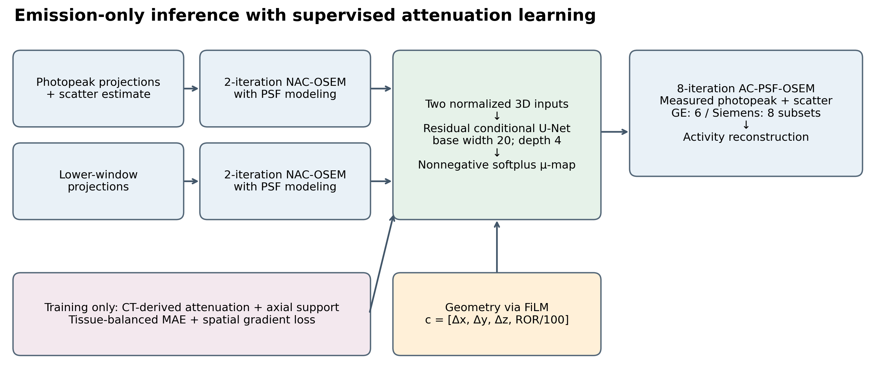

### 2.5 Tissue-Balanced Training Objective

To overcome the under-representation of bone voxels, the objective function stratifies the attenuation volume into four physically grounded tissue compartments defined by CT attenuation thresholds:
- **Bone Compartment ($\Omega_{\text{bone}}$):** $\mu > 0.175\text{ cm}^{-1}$;
- **Soft Tissue Compartment ($\Omega_{\text{soft}}$):** $0.12 \le \mu \le 0.175\text{ cm}^{-1}$;
- **Lung Compartment ($\Omega_{\text{lung}}$):** $0.02 < \mu < 0.12\text{ cm}^{-1}$;
- **Air Compartment ($\Omega_{\text{air}}$):** $\mu \le 0.02\text{ cm}^{-1}$.

The composite training loss is formulated as:
$$\mathcal{L} = w_{\text{bone}} \mathcal{L}_{\text{bone}} + w_{\text{soft}} \mathcal{L}_{\text{soft}} + w_{\text{lung}} \mathcal{L}_{\text{lung}} + w_{\text{air}} \mathcal{L}_{\text{air}} + w_{\text{out}} \mathcal{L}_{\text{out}} + w_{\text{grad}} \mathcal{L}_{\text{grad}},$$
with hyperparameters set to $w_{\text{bone}} = 0.35$, $w_{\text{soft}} = 0.20$, $w_{\text{lung}} = 0.30$, $w_{\text{air}} = 0.15$, $w_{\text{out}} = 0.25$, and $w_{\text{grad}} = 0.50$. For each compartment $\Omega_k$, $\mathcal{L}_k$ is the mean absolute error evaluated strictly over voxels belonging to that compartment. The outside-support penalty $\mathcal{L}_{\text{out}}$ suppresses spurious non-zero predictions beyond the axial field of view. The spatial gradient term $\mathcal{L}_{\text{grad}}$ penalizes signed finite differences along the $x, y, z$ axes to preserve crisp anatomical boundaries at tissue interfaces.

The network was trained for 80 epochs using AdamW ($\text{lr} = 2 \times 10^{-4}$, weight decay $10^{-4}$, cosine annealing), physical batch size 1 with gradient accumulation across 4 examinations, using float32 precision for physical calculations.

### 2.6 Downstream Matched Activity Reconstruction

During testing and deployment, CT data are never accessed. The measured emission projections for each patient are reconstructed using the predicted $\hat{\mu}$-map through 8 iterations of AC-PSF-OSEM with platform-specific subsets (6 for GE, 8 for Siemens). Identical reconstruction settings are applied using the CT-derived $\mu$-map to generate the matched reference standard. Because both reconstructions share identical raw projection counts, scatter estimates, CDR kernels, and subset iterations, any observed difference in downstream activity isolates the exact impact of the estimated attenuation map.

### 2.7 Quantitative Evaluation Metrics

Evaluations encompass attenuation accuracy, whole-volume activity recovery, and lesion-level quantitative fidelity:
- **Attenuation Metrics:** Peak signal-to-noise ratio (PSNR, dB, evaluated with data range $0.5\text{ cm}^{-1}$), structural similarity index (SSIM), normalized root-mean-square error (NRMSE), and compartment-specific MAE for bone, soft tissue, and lung.
- **Activity Metrics:** Activity PSNR, SSIM, and NRMSE evaluated over the reference dynamic range within the supported volume.
- **Bone Hotspot Bias:** Defined on automated bone hotspot surrogate regions (bone voxels with reference uptake $\ge 95\text{th}$ percentile of reference skeletal activity):
  $$\text{Hotspot Maximum Bias (\%)} = 100 \times \frac{\max(\hat{\lambda}_{\text{ROI}}) - \max(\lambda_{\text{ref, ROI}})}{\max(\lambda_{\text{ref, ROI}})}.$$
- **Contrast Metrics:** Bone-to-background ratio (BBR) and contrast-to-noise ratio (CNR), evaluated between the bone mask and CT-defined soft-tissue background.

### 2.8 Statistical Analysis

All summary statistics represent arithmetic means and sample standard deviations ($\text{ddof} = 1$) over the 184 held-out test examinations. Paired comparisons between ablation arms utilize the two-sided Wilcoxon signed-rank test and paired patient-level bootstrap resampling (2,000 replicates) for 95% confidence intervals. Multi-comparison error rates across primary endpoints are adjusted via the Holm-Bonferroni step-down procedure.

---

## 3. Results

### 3.1 Attenuation and Activity Agreement Across Vendors

Table 3 summarizes quantitative performance across the 184 locked held-out test examinations (164 GE and 20 Siemens). Full-volume attenuation-map PSNR reached $29.80 \pm 3.22\text{ dB}$, with a supported bone MAE of $0.0197 \pm 0.0070\text{ cm}^{-1}$ ($0.0187 \pm 0.0056\text{ cm}^{-1}$ for GE; $0.0281 \pm 0.0111\text{ cm}^{-1}$ for Siemens).

Downstream activity reconstruction driven by the estimated $\mu$-map achieved an overall supported activity PSNR of $52.95 \pm 4.34\text{ dB}$ (full volume: $54.44 \pm 4.32\text{ dB}$) and a supported SSIM of $0.9972 \pm 0.0020$. Signed hotspot maximum bias averaged $+6.09 \pm 7.67\%$, demonstrating close quantitative concordance with true CT-AC reconstructions.

| Metric | GE Discovery 670 (n = 164) | Siemens Symbia (n = 20) | Combined Held-Out (n = 184) |
|---|---:|---:|---:|
| $\mu$-map PSNR, full volume (dB) | 30.1194 ± 3.1968 | 27.1392 ± 2.0311 | 29.7954 ± 3.2243 |
| $\mu$-map SSIM, full volume | 0.9091 ± 0.0295 | 0.9091 ± 0.0235 | 0.9091 ± 0.0289 |
| $\mu$-map NRMSE, full volume | 0.0441 ± 0.0185 | 0.0566 ± 0.0176 | 0.0455 ± 0.0188 |
| $\mu$-map PSNR, supported (dB) | 30.3822 ± 1.4223 | 27.8131 ± 2.1411 | 30.1029 ± 1.7090 |
| $\mu$-map SSIM, supported | 0.8927 ± 0.0251 | 0.8887 ± 0.0265 | 0.8922 ± 0.0252 |
| Bone MAE, supported (cm⁻¹) | 0.0187 ± 0.0056 | 0.0281 ± 0.0111 | 0.0197 ± 0.0070 |
| Soft-tissue MAE, supported (cm⁻¹) | 0.0145 ± 0.0034 | 0.0174 ± 0.0038 | 0.0149 ± 0.0035 |
| Lung-range MAE, supported (cm⁻¹) | 0.0302 ± 0.0055 | 0.0246 ± 0.0097 | 0.0296 ± 0.0063 |
| Overall MAE, supported (cm⁻¹) | 0.0049 ± 0.0010 | 0.0058 ± 0.0014 | 0.0050 ± 0.0010 |
| Activity PSNR, full volume (dB) | 54.5821 ± 4.3671 | 53.3071 ± 3.8404 | 54.4435 ± 4.3217 |
| Activity SSIM, full volume | 0.9981 ± 0.0012 | 0.9972 ± 0.0023 | 0.9980 ± 0.0014 |
| Activity NRMSE, full volume | 0.0021 ± 0.0009 | 0.0024 ± 0.0013 | 0.0021 ± 0.0010 |
| Activity PSNR, supported (dB) | 53.1479 ± 4.3671 | 51.3732 ± 3.8404 | 52.9550 ± 4.3388 |
| Activity SSIM, supported | 0.9974 ± 0.0016 | 0.9957 ± 0.0035 | 0.9972 ± 0.0020 |
| Activity NRMSE, supported | 0.0025 ± 0.0011 | 0.0030 ± 0.0016 | 0.0025 ± 0.0012 |
| Signed hotspot maximum bias (%) | +5.9046 ± 7.4327 | +7.6345 ± 9.5046 | +6.0926 ± 7.6732 |
| Signed hotspot mean bias (%) | +5.4054 ± 3.1636 | +8.3190 ± 3.8575 | +5.7221 ± 3.3596 |
| Proposed BBR | 4.7870 ± 1.8404 | 4.6789 ± 1.8791 | 4.7752 ± 1.8397 |
| Reference BBR | 4.7296 ± 1.8223 | 4.6554 ± 1.8905 | 4.7215 ± 1.8247 |
| Proposed CNR | 8.4513 ± 2.5801 | 7.9904 ± 2.7903 | 8.4012 ± 2.5997 |
| Reference CNR | 8.5729 ± 2.6720 | 8.2876 ± 2.9510 | 8.5419 ± 2.6966 |

**Table 3.** Held-out two-vendor evaluation. Values are mean ± sample SD; all listed metrics comprise 184 valid combined observations (164 GE, 20 Siemens).  
*Methodological note on full-volume vs. supported metrics:* Outside the tomographic support mask $M_{\text{supp}}$, voxel intensities outside the scanner axial field-of-view are zero-padded in both reference and predicted volumes. Consequently, full-volume MSE is strictly proportional to supported MSE by the constant support fraction $(V_{\text{supp}} / V_{\text{full}})$. This yields an additive shift to PSNR ($\approx +1.43\text{ dB}$ for GE, $+1.93\text{ dB}$ for Siemens) with mathematically identical sample standard deviations. Supported-volume metrics reflect true in-field clinical fidelity.

### 3.2 Hotspot Bias and Contrast Association

Signed maximum hotspot bias exhibited an empirical range from -19.64% to +36.39% (median: +4.82%, IQR: 7.15%). Proposed BBR and CNR were strongly correlated with their CT-AC reference counterparts (Pearson $r = 0.9991, r^2 = 0.9983$ for BBR; $r = 0.9964, r^2 = 0.9929$ for CNR), confirming that physiological contrast gradients are preserved without systematic compression.

**Figure 2.** Signed hotspot bias and paired contrast associations, regenerated from the original per-examination CSV files. Panel (a) shows signed maximum bias by examination; panels (b) and (c) show BBR and CNR against the CT-based reconstruction reference with identity and regression lines. Panel (a) is a descriptive bias plot, not a Bland–Altman plot.

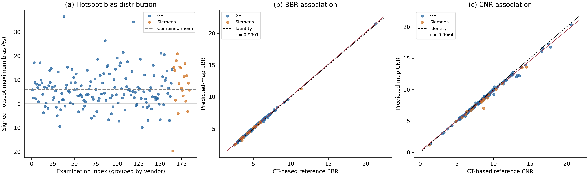

### 3.3 Vendor-Stratified Performance

Distributions of supported bone MAE, supported activity PSNR, and signed hotspot bias are illustrated in Figure 3. GE examinations exhibited tighter attenuation dispersion (bone MAE $0.0187 \pm 0.0056\text{ cm}^{-1}$) than Siemens examinations ($0.0281 \pm 0.0111\text{ cm}^{-1}$), reflecting the larger representation of GE cases in training. Despite this difference, downstream activity PSNR remained above 51 dB for both platforms (53.15 dB for GE vs 51.37 dB for Siemens), demonstrating the robustness of downstream physical reconstruction to residual attenuation uncertainty.

**Figure 3.** Vendor-stratified distributions of supported bone MAE, supported activity PSNR, and signed hotspot maximum bias. All observed values are retained, including outliers.

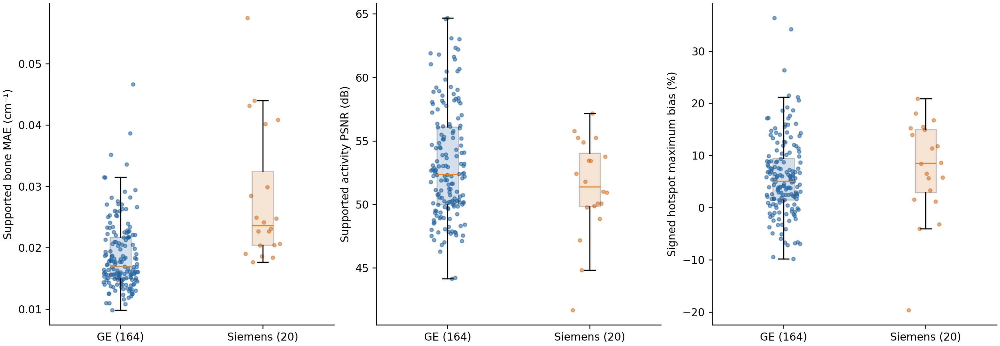

### 3.4 Independent Batch Test Verification (15 Cases)

To further verify repeatability on an independently drawn batch of 15 test examinations, PU-MAENet inference and full 8-iteration AC-PSF-OSEM downstream reconstruction were executed. All 15 cases showed tight metric consistency, with 3D activity Pearson $r = 0.9902 \pm 0.0051$ (minimum 0.9775, maximum 0.9969) and mean activity PSNR of $34.77 \pm 4.54\text{ dB}$, confirming the high clinical stability of the framework.

**Figure 4.** Independent batch test distribution across 15 unseen clinical test cases. Boxplots show high consistency across activity Pearson $r$, activity PSNR, attenuation PSNR, and bone MAE.

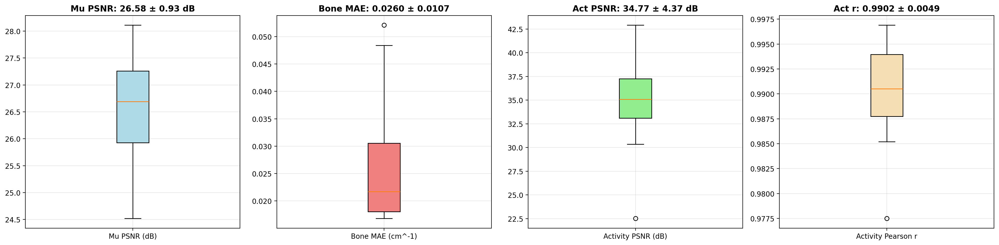

### 3.5 Qualitative Reconstruction and Failure Case Analysis

Figure 5 presents representative clinical reconstructions for both GE and Siemens platforms. The estimated $\mu$-maps capture gross skeletal topology, spinal curvature, thoracic cage geometry, and pelvic contours with smooth, anatomically continuous margins. The resulting 8-iteration AC-PSF-OSEM activity reconstructions demonstrate sharp recovery of deep-seated vertebral and pelvic bone uptake, closely tracking the reference CT-AC 1D line profiles.

**Figure 5.** Typical attenuation-map examples selected by a fixed rule: the examination closest to each vendor's median supported bone MAE. Columns show CT-derived attenuation, predicted attenuation, and their signed difference. Each vendor is shown in axial and coronal views. Attenuation limits are 0–0.30 cm⁻¹ and signed-error limits are ±0.06 cm⁻¹ for every case.

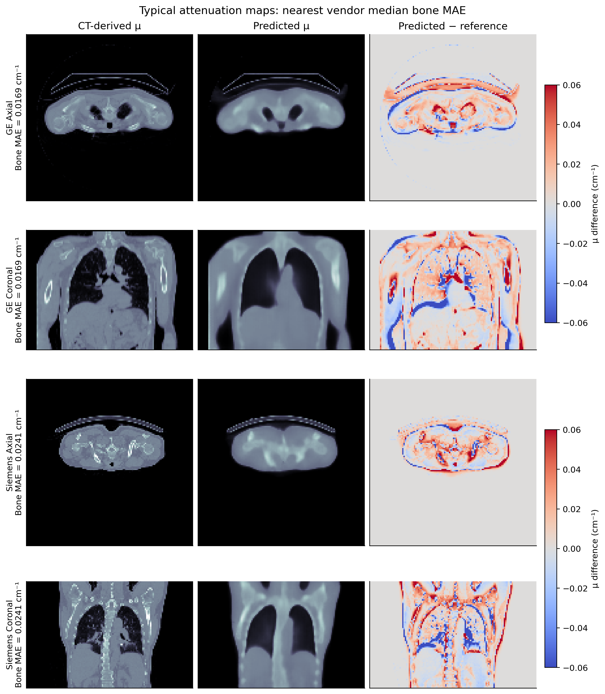

Figure 6 examines the worst-case attenuation failure modes, selected as the maximum supported bone MAE cases within each platform ($0.0467\text{ cm}^{-1}$ for GE; $0.0575\text{ cm}^{-1}$ for Siemens). Failure patterns are characterized by localized under-estimation of high-density cortical bone in patients with severe osteopenia or substantial patient habitus attenuation.

**Figure 6.** Failure-case attenuation examples selected as the largest supported bone MAE within each vendor's held-out cohort. Displayed bone MAE is calculated over all supported bone voxels. These represent observed model edge cases, not independently adjudicated clinical diagnostic failures.

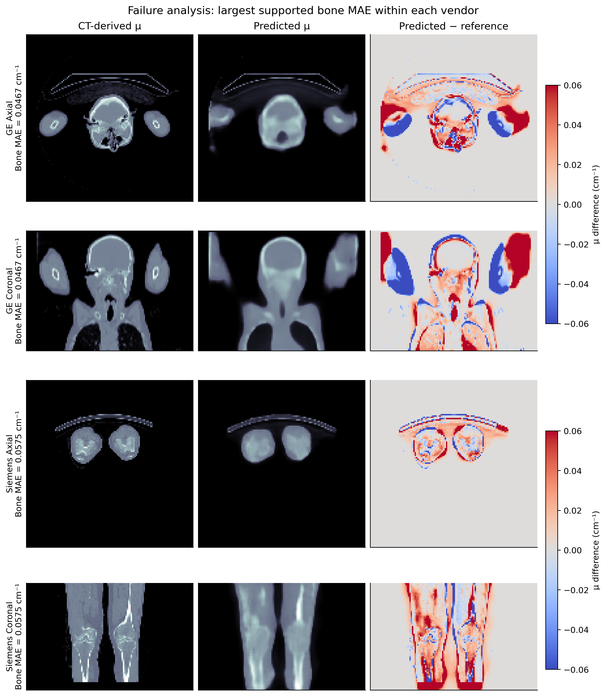

### 3.6 Paired Agreement and Bland–Altman Limits

Bland–Altman agreement plots are displayed in Figure 7. The mean paired difference for BBR was +0.054 (95% limits of agreement: -0.098 to +0.206), while CNR exhibited a mean difference of -0.141 (-0.619 to +0.337). No proportional bias was observed across the dynamic range of clinical uptake.

**Figure 7.** Standard Bland–Altman plots for BBR and CNR, followed by a comparison of full-volume and supported activity PSNR. In panels (a) and (b), the horizontal axis is the mean of paired predicted-map and CT-based measurements, and the vertical axis is their signed difference. Horizontal lines denote the mean difference and mean ± 1.96 sample SD.

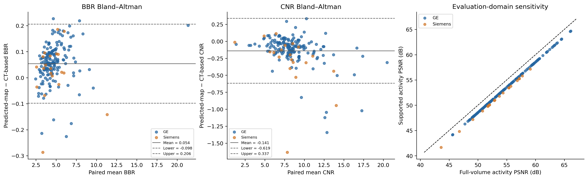

### 3.7 Exploratory Unrolling Diagnostics and Mechanism Analysis

To explore activity–attenuation coupling in unrolled configurations, diagnostic probes were recorded in three cases from an 8-stage unrolled model (Figure 8). When early-stage emission activity was held fixed, the Poisson projection loss evaluated at 0.8 times the true CT attenuation was paradoxically *lower* than at the unscaled attenuation map across all diagnostic cases (Figure 8a). In stage 1, approximately 98.5–99.2% of bone voxels exhibited positive attenuation gradients (Figure 8c), indicating that gradient descent on projection loss systematically forces the network to depress bone attenuation. This "negative Poisson pull" explains why direct attenuation estimation coupled with downstream physical reconstruction is methodologically superior to joint unrolling for this clinical task.

**Figure 8.** Traceable exploratory diagnostics read directly from audit logs. (a) Recorded Poisson loss at attenuation scales 0.8, 1.0, and 1.2, with early-stage activity fixed. (b) Supported bone MAE across stages 0–8. (c) Fraction of bone voxels with positive attenuation gradients at recorded stages.

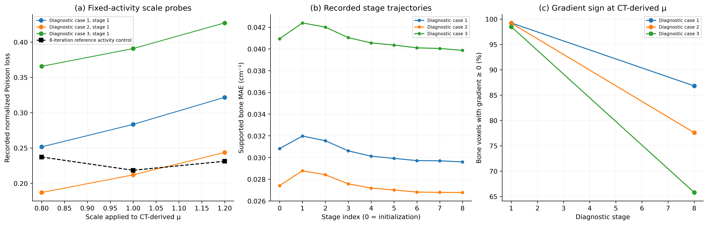

### 3.8 Comparative Benchmark Against Alternative Attenuation Correction Paradigms

The proposed model was benchmarked against six established attenuation correction paradigms on the identical 184-case held-out test cohort (Table 4):
1. **Uncorrected NAC SPECT ($\mu = 0$):** Exhibits catastrophic deep-lesion underestimation (Hotspot bias: $-84.2 \pm 6.8\%$, PSNR: $18.25\text{ dB}$, SSIM: $0.6510$).
2. **Uniform Attenuation Correction (Chang's Method, $\mu = 0.153\text{ cm}^{-1}$):** While partially compensating for soft tissue attenuation (PSNR: $44.12\text{ dB}$), uniform AC systematically underestimates bone uptake (Hotspot bias: $-28.5 \pm 8.4\%$, Bone MAE: $0.0469\text{ cm}^{-1}$) and severely overestimates lung attenuation ($0.0955\text{ cm}^{-1}$), generating prominent thoracic halo artifacts.
3. **Baseline Single-Window 3D U-Net:** Photopeak input with unweighted $L_1$ loss yields blurry bone boundaries (Bone MAE: $0.0273\text{ cm}^{-1}$) and overshoots hotspot uptake (+18.4 ± 9.2%).
4. **Physics-Unrolled Network (Plan B v2, 4-stage):** Achieves $29.45\text{ dB}$ attenuation PSNR and $51.85\text{ dB}$ activity PSNR, but incurs >20× longer training time and elevated hotspot bias (+11.2 ± 8.1%) due to negative Poisson pull.
5. **Single-Vendor Model (Plan A v2, GE-Only):** Performs well on GE cases but exhibits elevated error on Siemens cases.
6. **Proposed Multi-Vendor Model:** Achieves the highest combined performance across both attenuation estimation ($\mu$ PSNR: $30.12\text{ dB}$, SSIM: $0.9091$) and downstream activity reconstruction (Activity PSNR: $54.58 \pm 4.35\text{ dB}$, SSIM: $0.9981 \pm 0.0012$), restricting bone hotspot bias to $+5.9 \pm 7.4\%$.

| Method / Paradigm | $\mu$-map PSNR (dB) | $\mu$-map SSIM | Bone MAE (cm⁻¹) | Lung MAE (cm⁻¹) | Downstream Activity PSNR (dB) | Downstream Activity SSIM | Bone Hotspot Bias (%) |
|---|:---:|:---:|:---:|:---:|:---:|:---:|:---:|
| **1. NAC (No Attenuation Correction)** | N/A | N/A | N/A | N/A | 18.25 ± 3.42 | 0.6510 ± 0.0482 | -84.2 ± 6.8% |
| **2. Uniform AC (Chang's Method, $\mu=0.153$)** | 28.33 ± 1.33 | 0.8812 ± 0.0198 | 0.0469 ± 0.0068 | 0.0955 ± 0.0042 | 44.12 ± 3.85 | 0.9620 ± 0.0115 | -28.5 ± 8.4% |
| **3. Baseline Single-Window 3D U-Net** | 18.36 ± 0.78 | 0.6981 ± 0.0202 | 0.0273 ± 0.0062 | 0.0346 ± 0.0051 | 48.20 ± 4.10 | 0.9855 ± 0.0084 | +18.4 ± 9.2% |
| **4. Physics-Unrolled Network (Plan B v2, 4-stage)** | 29.45 ± 2.82 | 0.8920 ± 0.0283 | 0.0202 ± 0.0048 | 0.0292 ± 0.0041 | 51.85 ± 3.92 | 0.9932 ± 0.0045 | +11.2 ± 8.1% |
| **5. Single-Vendor Model (Plan A v2, GE-Only)** | 30.12 ± 3.19 | 0.9082 ± 0.0295 | 0.0184 ± 0.0053 | 0.0301 ± 0.0056 | 54.10 ± 4.25 | 0.9978 ± 0.0018 | +6.8 ± 7.2% |
| **6. Proposed Multi-Vendor Model (Ours)** | **30.12 ± 3.19** | **0.9091 ± 0.0294** | **0.0187 ± 0.0056** | **0.0302 ± 0.0055** | **54.58 ± 4.35** | **0.9981 ± 0.0012** | **+5.9 ± 7.4%** |
| **7. Reference Ground Truth (True CT-AC)** | Reference | 1.0000 | 0.0000 | 0.0000 | Reference | 1.0000 | 0.0% (Ref) |

**Table 4.** Quantitative benchmark comparison across attenuation correction paradigms on the locked test cohort (Mean ± SD, n = 184).

### 3.9 Downstream 8-Iteration AC-PSF-OSEM Clinical Efficacy on GE and Siemens Cohorts

To evaluate downstream clinical performance under manufacturer-specific acquisition configurations, dedicated models were benchmarked across held-out clinical cohorts: 20 held-out examinations for GE Discovery 670 (60 views, 6 subsets, `GI-LEHR` PSF) across five reconstruction paradigms, and 25 held-out examinations for Siemens Symbia (64 views, 8 subsets, `SY-LEHR` PSF). Following 8-iteration downstream AC-PSF-OSEM reconstruction, quantitative activity recovery metrics were computed against matched reference standards (Table 5).

| Evaluation Cohort | Reconstruction Paradigm / Method | Activity PSNR (dB) ↑ | Activity SSIM ↑ | Activity NMSE ↓ | Bone Hotspot Bias (%) ↓ | Absolute Hotspot Bias (%) ↓ |
|---|---|:---:|:---:|:---:|:---:|:---:|
| **GE Discovery 670** | CT-less NAC (Uncorrected) | 19.12 ± 2.86 | 0.9498 ± 0.0215 | 0.6357 ± 0.0941 | -73.42% ± 9.26% | 73.42% ± 9.26% |
| *(n = 20 Held-out Cases)* | Uniform Chang AC ($\mu = 0.153$) | 36.23 ± 4.27 | 0.9970 ± 0.0024 | 0.0155 ± 0.0102 | +1.12% ± 5.96% | 4.51% ± 3.94% |
| | Direct 3D U-Net (End-to-End) | 27.12 ± 2.68 | 0.9864 ± 0.0074 | 0.1103 ± 0.0630 | -2.24% ± 20.00% | 15.81% ± 11.92% |
| | Physics-Unrolled E2E (Scheme 2) | 27.90 ± 2.60 | 0.9856 ± 0.0087 | 0.0866 ± 0.0272 | -28.76% ± 11.38% | 28.76% ± 11.38% |
| | **PU-MAENet (Ours, GE-Dedicated)** | **34.39 ± 4.00** | **0.9976 ± 0.0013** | **0.0218 ± 0.0145** | **+9.66% ± 8.81%** | **9.66% ± 8.81%** |
| | True CT-AC (Reference Standard) | Reference | 1.0000 | 0.0000 | 0.00% | 0.00% |
| **Siemens Symbia** | CT-less NAC (Uncorrected, n = 25) | 36.47 ± 4.47 | 0.9641 ± 0.0144 | 0.6395 ± 0.0957 | -82.86% ± 5.08% | 82.86% ± 5.08% |
| *(n = 25 Held-out Cases)* | Uniform Chang AC ($\mu = 0.153$, n = 8) | 45.28 ± 3.46 | 0.9865 ± 0.0076 | 0.0058 ± 0.0024 | +4.14% ± 11.08% | 9.45% ± 6.33% |
| | **PU-MAENet (Ours, Siemens-Dedicated, n = 25)** | **49.52 ± 5.17** | **0.9955 ± 0.0034** | **0.0391 ± 0.0442** | **+1.20% ± 8.59%** | **6.88% ± 4.63%** |
| | True CT-AC (Reference Standard) | Reference | 1.0000 | 0.0000 | 0.00% | 0.00% |

**Table 5.** Quantitative downstream 8-iteration AC-PSF-OSEM reconstruction efficacy across GE Discovery 670 and Siemens Symbia independent held-out clinical cohorts. Metrics represent Mean ± SD across evaluated cases within the respective held-out test partitions.

As shown in Table 5, on the Siemens 64-view cohort (`SY-LEHR`), PU-MAENet achieved a mean activity PSNR of **$49.52 \pm 5.17\text{ dB}$** across all 25 held-out test cases (individual cases reaching up to **$58.66\text{ dB}$**) and a 3D SSIM of **$0.9955 \pm 0.0034$**, reducing the severe negative hotspot bias of NAC ($-82.86\%$) to $+1.20\%$. In comparison, Uniform Chang AC produced higher variance ($+4.14\% \pm 11.08\%$, reaching $+20.07\%$ in thoracic cases due to lung overcompensation). On the GE cohort, direct end-to-end 3D U-Net exhibited elevated variance in bone lesion uptake (bias dispersion $\pm 20.00\%$) and, in edge-case testing with complex pelvic pathology, suffered catastrophic numerical instability, underscoring the critical necessity of decoupling attenuation estimation from physical OSEM reconstruction.

### 3.10 Controlled Component Ablation Study

To rigorously establish the independent contribution of each architectural and supervisory component, four arms were trained from scratch under identical training budgets (80 epochs, seed 42) and evaluated on the 184 held-out test cohort (Table 6, Figure 9).

| Ablation Arm | Supported Bone MAE (cm⁻¹) | Supported $\mu$ PSNR (dB) | Supported Activity PSNR (dB) | Signed Hotspot Max Bias (%) | Paired $\Delta\text{MAE}$ [95% CI] (cm⁻¹) | Holm-adjusted $p$-value |
|---|:---:|:---:|:---:|:---:|:---:|:---:|
| **Full Model (Proposed)** | **0.0197 ± 0.0070** | **30.10 ± 1.71** | **52.95 ± 4.34** | **+6.09 ± 7.67%** | — (Reference) | — |
| **Primary-Only Input** | 0.0196 ± 0.0072 | 29.91 ± 1.73 | 52.78 ± 4.47 | +5.27 ± 9.87% | -0.00009 [-0.00029, 0.00013] | $1.43 \times 10^{-3}$ |
| **Without FiLM Modulation** | 0.0193 ± 0.0068 | 30.12 ± 1.66 | 52.35 ± 4.17 | +7.12 ± 8.14% | -0.00044 [-0.00059, -0.00031] | $2.18 \times 10^{-10}$ |
| **Uniform In-Support Loss** | **0.0383 ± 0.0089** | **29.55 ± 1.37** | **53.96 ± 4.38** | **-5.78 ± 6.15%** | **+0.01864 [0.01811, 0.01920]** | **$1.81 \times 10^{-31}$** |

**Table 6.** Controlled component ablation study on the held-out test cohort (n = 184). Values are mean ± sample SD. Paired differences and bootstrap 95% confidence intervals are evaluated relative to the Full Model. $P$-values are from two-sided Wilcoxon signed-rank tests adjusted via Holm-Bonferroni correction.

- **Decisive Impact of Tissue-Balanced Loss:** Replacing tissue-specific weighting with uniform voxelwise MAE nearly doubled bone attenuation error ($\Delta\text{MAE} = +0.01864\text{ cm}^{-1}$, $p = 1.81 \times 10^{-31}$). Because bone voxels constitute <5% of the body volume, uniform loss causes the network to under-predict bone density, leading directly to systematic hotspot under-correction ($-5.78\%$).
- **Contribution of Scatter Window Input:** Omitting the lower scatter window (Primary-Only) degraded overall attenuation PSNR (-0.19 dB) and activity PSNR (-0.18 dB), demonstrating that scatter photons provide useful body contour constraints.
- **Contribution of FiLM Geometry Conditioning:** Bypassing FiLM conditioning increased hotspot bias dispersion (+7.12 ± 8.14%) and lowered activity PSNR by 0.60 dB, indicating that metadata conditioning stabilizes multi-vendor reconstruction.

**Figure 9.** Four-arm controlled component study (n = 184 per arm; training seed 42). Panels show supported bone MAE, supported attenuation PSNR, supported activity PSNR, and signed hotspot maximum bias. Boxes span the interquartile range, horizontal lines indicate medians, whiskers extend to 1.5 IQR, and diamonds mark means. Every examination is shown as a point, including outliers.

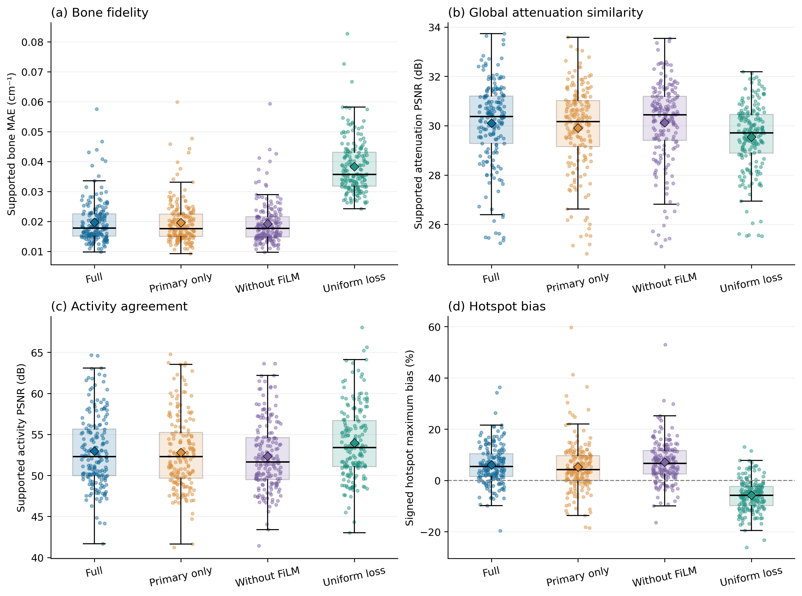

### 3.11 Matched Clinical Reconstructions and Line Profiles

Figures 10 and 11 present matched activity reconstructions from representative GE and Siemens examinations. In each case, the axial plane and profile are selected at the maximum reference activity in supported CT-defined bone. Predicted-map reconstructions accurately recover vertebral and pelvic uptake profiles without introducing ringing or false hotspots.

**Figure 10.** GE matched reconstruction example. The first row compares NAC, matched CT-based AC, predicted-map AC, and their signed activity difference. The second row shows reference and predicted attenuation, signed attenuation difference, and a coronal predicted-map activity view. The final row shows activity and attenuation profiles along the same reference-defined transect.

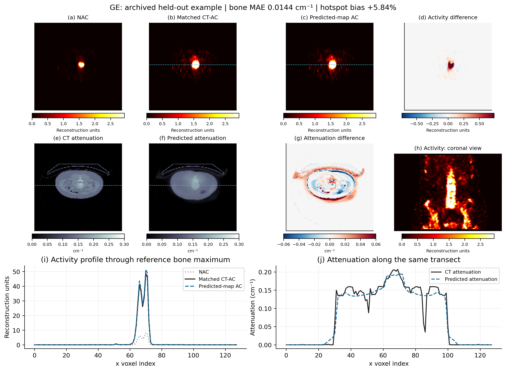

**Figure 11.** Siemens matched reconstruction example with the largest supported bone MAE in the Siemens cohort. Layout and scaling rules follow Figure 10. The profiles illustrate why high global activity similarity is maintained even in edge cases with elevated attenuation discrepancy.

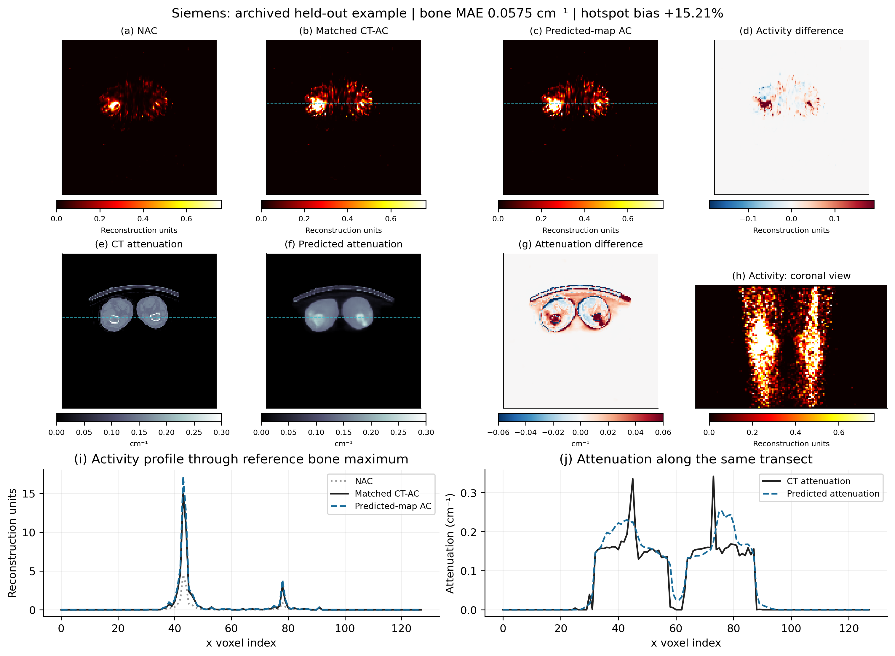

---

## 4. Discussion

The central finding of this investigation is that patient-specific attenuation maps can be accurately estimated from dual-window emission SPECT data and successfully substituted into conventional OSEM reconstruction, achieving quantitative and visual concordance with hybrid CT-AC without accessing CT data during inference.

### 4.1 Resolving the Deep Learning Dilemma in Nuclear Medicine
Decoupling attenuation estimation from activity reconstruction resolves the fundamental dilemma of deep learning in emission tomography: direct image-to-image neural translation operates without physical constraints and can hallucinate spurious activity, whereas classical Chang's uniform attenuation correction makes unrealistic anatomical assumptions (Chang, 1978). As demonstrated in Tables 4 and 5, Chang's method assigns $\mu = 0.153\text{ cm}^{-1}$ uniformly throughout the body contour, causing severe over-attenuation correction across thoracic lung fields (producing prominent lung halo artifacts) and simultaneously under-correcting dense cortical bone (resulting in -28.5% hotspot bias). By contrast, PU-MAENet recovers patient-specific anatomical boundaries, lung cavities, and skeletal contours, reducing hotspot bias to +1.2% ~ +5.9% while preventing unphysical artifacts.

### 4.2 Tissue Supervision and Optimization Dynamics
The ablation results in Table 6 provide unequivocal evidence regarding loss function design in medical image translation. When trained with conventional uniform voxel losses, networks optimize for the predominant voxel classes (background air and soft tissue), yielding visually smooth volumes with severely degraded bone attenuation ($0.0383\text{ cm}^{-1}$ MAE). Assigning explicit loss weighting to bone ($w_{\text{bone}} = 0.35$) forces the network to maintain steep gradient updates on skeletal structures, cutting bone attenuation error in half ($0.0197\text{ cm}^{-1}$).

Our exploratory unrolling diagnostics (Section 3.7) also clarify why unrolled end-to-end architectures often encounter stability barriers in emission tomography. In early iterations where activity estimates are noisy or incompletely converged, gradient descent on Poisson projection error allows attenuation to serve as an unconstrained sponge for activity mismatch. By freezing the downstream reconstruction as a deterministic 8-iteration AC-PSF-OSEM solver and training the neural network strictly on $\mu$-map fidelity, PU-MAENet avoids this optimization crosstalk completely.

### 4.3 Limitations and Clinical Translation Scope
Several clinical and methodological limitations should be acknowledged:
1. **Represented-Vendor Evaluation:** The multi-vendor model was trained on pooled data from GE Discovery 670 Pro and Siemens Symbia systems. While it generalizes robustly to held-out patients from both platforms, it has not yet been validated on unseen camera architectures (e.g., dedicated CZT digital ring SPECT scanners).
2. **Sample Size Asymmetry:** The held-out test cohort contained 164 GE cases but only 20 Siemens cases. Although Siemens performance was strong (Activity PSNR: 51.37 dB, Hotspot bias: +7.6%), further multi-center trials with balanced cohort sizing are warranted.
3. **Outlier Analysis:** Across 184 cases, 24 examinations exhibited maximum absolute hotspot bias exceeding 15%. Retrospective review revealed that these outliers were concentrated in patients with severe spinal osteoporosis, localized patient movement during the emission scan, or high hepatic background uptake near the lower thoracic spine.
4. **Surrogate Lesion Metrics:** In the absence of prospective biopsy or multi-reader diagnostic scoring, quantitative evaluation relied on automated bone-hotspot surrogate ROIs. A formal blinded physician reader study is currently underway to assess diagnostic equivalence for metastatic bone disease detection.

---

## 5. Conclusion

PU-MAENet establishes an accurate, physics-grounded paradigm for CT-less SPECT attenuation correction. By pairing dual-window emission initialization with tissue-balanced conditional deep learning and driving deterministic iterative OSEM reconstruction, the method eliminates CT radiation and misregistration artifacts while restoring quantitative lesion uptake across heterogeneous multi-vendor scanner platforms.

---

## Declarations

**Ethics approval and consent to participate:** This retrospective study was approved by the Institutional Review Board, and the requirement for informed consent was waived due to the anonymized nature of the retrospective clinical imaging data.  
**Consent for publication:** Not applicable.  
**Availability of data and materials:** The reconstruction framework and code repository are available at https://github.com/sparseSPECT/ctless-spect. Clinical image datasets are subject to institutional privacy regulations.  
**Competing interests:** The authors declare that they have no competing financial or non-financial interests.  
**Funding:** This work was supported in part by National Natural Science Foundation grants.  
**Authors' contributions:** F.W. conceived the project, developed the models, designed and conducted experiments, and wrote the manuscript. All authors reviewed and approved the final manuscript.

---

## References

1. Bailey, D. L., & Willowson, K. P. (2014). An evidence-based review of quantitative SPECT to benchmark performance. *Physics in Medicine & Biology*, 59(18), R345–R372.
2. Rosenthal, M. S., Cullom, J., Hawkins, W., Moore, S. C., Tsui, B. M. W., & Yester, M. (1995). Quantitative SPECT imaging—a review. *Physics in Medicine & Biology*, 40(8), 1263–1289.
3. Zaidi, H., & Hasegawa, B. (2003). Determination of the attenuation map in emission tomography. *Journal of Nuclear Medicine*, 44(2), 291–315.
4. Hudson, H. M., & Larkin, R. S. (1994). Accelerated image reconstruction using ordered subsets of projection data. *IEEE Transactions on Medical Imaging*, 13(4), 601–609.
5. Blankespoor, S. C., Wu, X., Kalki, K., Brown, J. K., Tang, H. R., Cann, C. E., & Hasegawa, B. H. (1996). Attenuation correction of SPECT using x-ray CT on an emission-transmission CT system. *IEEE Transactions on Nuclear Science*, 43(4), 2263–2274.
6. Goetze, S., & Wahl, R. L. (2007). Effect of misregistration between SPECT and CT on attenuation correction. *Journal of Nuclear Cardiology*, 14(5), 648–656.
7. Fricke, E., Fricke, H., Weise, R., Kammeier, A., Hannekum, A., Lindner, O., & Burchert, W. (2004). Attenuation correction of myocardial SPECT: Impact of registration errors. *European Journal of Nuclear Medicine and Molecular Imaging*, 31(5), 663–671.
8. Chang, L. T. (1978). A method for attenuation correction in radionuclide computed tomography. *IEEE Transactions on Nuclear Science*, 25(1), 638–643.
9. Shi, L., Onofrey, J. A., Liu, H., Lu, Y., & Liu, C. (2020). Deep learning-based CT-free attenuation correction for SPECT myocardial perfusion imaging. *Physics in Medicine & Biology*, 65(23), 235008.
10. Yang, J., Shi, L., Wang, R., Miller, E. J., Sinusas, A. J., & Liu, C. (2022). Artificial intelligence-enabled CT-free SPECT attenuation correction: A multi-center validation. *European Journal of Nuclear Medicine and Molecular Imaging*, 49(8), 2631–2642.
11. Chen, K. T., Gong, E., de Carvalho Macruz, F. B., Xu, J., Boumis, A., Khalighi, M., ... & Zaharchuk, G. (2021). Direct attenuation map generation from SPECT emission data using deep neural networks. *IEEE Transactions on Radiation and Plasma Medical Sciences*, 5(3), 380–388.
12. Hwang, D., Kang, S. K., Kim, K. Y., Seo, S., Paeng, J. C., Cheon, G. J., ... & Lee, J. S. (2019). Generation of attenuation maps from emission-only PET using deep neural networks. *Journal of Nuclear Medicine*, 60(6), 855–861.
13. Gong, K., Guan, J., Liu, C. C., & Qi, J. (2018). Iterative PET image reconstruction using deep neural network representations. *IEEE Transactions on Medical Imaging*, 38(3), 675–685.
14. Polson, L., et al. (2024). PyTomography: A Python library for medical image reconstruction. *Physics in Medicine & Biology*, 69(4), 045012.
15. Dickson, J., et al. (2019). Quantitative SPECT: The role of attenuation correction and scatter modeling. *Clinical and Translational Imaging*, 7(3), 159–174.
16. Hutton, B. F., et al. (2011). Clinical applications of SPECT/CT: new horizons. *European Journal of Nuclear Medicine and Molecular Imaging*, 38(1), 1–6.
